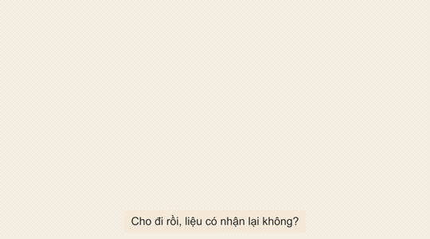

<div align="center">

# Whiteboard Video

**Biến một chủ đề, kịch bản hoặc file phụ đề `.srt` thành video vẽ tay bảng trắng hoàn chỉnh, có giọng đọc và phụ đề tiếng Việt.**

AI agent viết kịch bản · tạo giọng đọc · phân cảnh · tạo ảnh · dựng hiệu ứng bàn tay vẽ · xuất MP4

[](LICENSE)


**[Xem thử](#xem-thử)** &nbsp;·&nbsp; **[Bắt đầu nhanh](#bắt-đầu-nhanh)** &nbsp;·&nbsp; **[Dùng với AI agent](#dùng-với-ai-agent)** &nbsp;·&nbsp; **[Cài đặt](#cài-đặt)** &nbsp;·&nbsp; **[Dùng bằng lệnh](#dùng-thủ-công-bằng-lệnh)** &nbsp;·&nbsp; **[Lỗi thường gặp](#lỗi-thường-gặp)** &nbsp;·&nbsp; **[Cộng đồng](#cộng-đồng-và-các-mẫu-video-khác)**

<br>



</div>

<br>

Phù hợp cho video kể chuyện ngắn, bài giảng, giải thích kiến thức và nội dung TikTok / Reels / Shorts.

> [!NOTE]
> Phát triển tiếp từ [geeklee/srt-whiteboard-animation](https://github.com/geeklee/srt-whiteboard-animation) của tác giả 江哥是老登啊. Bản này bổ sung giọng đọc tiếng Việt, làm video từ chủ đề / kịch bản, chế độ nhịp gọn, gắn phụ đề và tài liệu tiếng Việt.

## Xem thử

| Dự án | Nội dung | Xem |
|---|---|---|
| **Cho đi và nhận lại** | Nam trao chiếc ô duy nhất cho một cậu bé trú mưa; vài tuần sau, một người thợ xa lạ dừng lại giúp Nam sửa xe. Hai cảnh vẽ lần lượt theo lời kể. | Ảnh động ở trên · [cảnh 1](examples/cho-di-nhan-lai-scene-01.png) · [cảnh 2](examples/cho-di-nhan-lai-scene-02.png) |
| **Vì sao điện thoại càng dùng càng chậm?** | Video giải thích kiến thức làm từ một chủ đề: ba nguyên nhân và cách khắc phục, có giọng đọc và phụ đề. | [Facebook Reel](https://www.facebook.com/reel/1645434740472048) |

## Tính năng

| ✍️ **Từ chủ đề đến video** | 🎙️ **Giọng đọc tiếng Việt** | 🖊️ **Vẽ theo lời kể** |
|---|---|---|
| Đưa một chủ đề, kịch bản hoặc file SRT. Agent viết kịch bản, phân cảnh, tạo ảnh và dựng video. | [CIT Voice Studio](https://github.com/Cuongyd196/cit-voice-studio) (offline, miễn phí), Edge TTS hoặc Vbee. Phụ đề sinh theo độ dài giọng thật. | Mỗi cảnh chia thành nhiều vùng, vẽ đúng thứ tự câu đang đọc. Vùng chưa tới lượt hoàn toàn ẩn. |
| 🎨 **Nét bút liền mạch** | 🧭 **Chỉnh trực quan** | ⏱️ **Nhịp gọn** |
| Đi nét đen trước (`ink`), tô màu sau (`color`), bàn tay cầm bút bám theo nét. | Trang xem trước trên trình duyệt để kéo chỉnh vùng, thứ tự và thời gian. | Với SRT có sẵn, co thời gian vẽ theo giọng đọc để bỏ khoảng lặng thừa. |

## Bắt đầu nhanh

**1. Tải repo và cài môi trường** (cần [Python 3.10+](https://www.python.org/downloads/) và [ffmpeg](https://ffmpeg.org/download.html) trong PATH)

```bash
git clone https://github.com/Cuongyd196/whiteboard-video.git
cd whiteboard-video
python scripts/prepare_env.py
```

**2. Cài giọng đọc** — tải [CIT Voice Studio](https://github.com/Cuongyd196/cit-voice-studio/releases/latest) và mở ứng dụng ([hướng dẫn](#cài-cit-voice-studio)). Không cài thì đặt `TTS_PROVIDER=edge` trong `.env` để dùng Edge TTS.

**3. Mở thư mục bằng AI agent và yêu cầu:**

```text
Dùng skill whiteboard-video làm video vẽ tay 60 giây về chủ đề "AI Agent khác chatbot ở điểm nào".
```

Agent làm từng bước và dừng chờ bạn duyệt. Muốn chạy một mạch tới MP4, nói thêm "thực hiện tự động tất cả các bước".

## Dùng với AI agent

Repo đã khai báo skill sẵn, agent tự nhận ra mà không cần cài thêm:

| Agent | File agent đọc |
|---|---|
| Claude Code | `.claude/skills/whiteboard-video/SKILL.md` |
| Codex (CLI / app / IDE) | `.agents/skills/whiteboard-video/SKILL.md` |
| Google Antigravity | `.agent/skills/whiteboard-video/SKILL.md` |
| Gemini CLI | `GEMINI.md` |
| Cursor, GitHub Copilot, agent khác | `AGENTS.md` |

Các file trên chỉ trỏ về [SKILL.md](SKILL.md) ở thư mục gốc, nơi chứa toàn bộ quy trình: sửa một chỗ, mọi agent đều nhận. Nếu đổi `name` / `description` ở đầu `SKILL.md`, chạy `python scripts/sync_skill_entries.py` để cập nhật các file lối vào.

### Ba kiểu đầu vào

| Bạn có | Agent bắt đầu từ |
|---|---|
| **Một chủ đề** ("cho đi và nhận lại") | Viết kịch bản → bạn duyệt |
| **Một kịch bản** (đoạn văn lời dẫn) | Tạo giọng đọc → tự sinh SRT khớp giọng |
| **File SRT** | Chia cảnh |

Với chủ đề hoặc kịch bản, skill làm theo kiểu **giọng đọc dẫn nhịp**: đọc trước, lấy độ dài giọng thật làm mốc phụ đề rồi mới vẽ theo mốc đó, nên video không có khoảng lặng thừa.

<details>
<summary><b>Ví dụ câu lệnh</b></summary>

<br>

Từ chủ đề:

```text
Dùng skill whiteboard-video làm video vẽ tay 60 giây, chủ đề "cho đi và nhận lại".
Kể bằng một câu chuyện ngắn, giọng ấm, kết bằng một câu đọng lại. Giọng Edge nam, có phụ đề.
Trả lời bằng tiếng Việt.
```

Từ kịch bản có sẵn:

```text
Dùng skill whiteboard-video làm video hoàn chỉnh từ kịch bản dưới đây.
Giọng Vbee n_hanoi_male_protrainer_education_vc, tốc độ 1.1. Trả lời bằng tiếng Việt.

Cho đi rồi, liệu có nhận lại không?

Chiều ấy, Nam thấy một cậu bé ôm chồng sách đứng trú mưa. ...
```

Sau khi có video:

```text
Gắn phụ đề vào video.
Thêm giọng đọc bằng CIT Voice Studio, giọng Trúc Ly.
Thêm giọng đọc bằng Edge TTS.
Thêm giọng đọc Vbee, giọng n_hanoi_male_protrainer_education_vc.
Giọng đọc và hình bớt khoảng lặng cho video hấp dẫn hơn.     ← chế độ nhịp gọn
Nghỉ lâu hơn sau câu "Chiếc ô không trở lại".
Đổi sang giọng nữ vi-VN-HoaiMyNeural.
Cảnh 2 vẽ chiếc ô trước bác thợ.
Thay cây bút, không hiển thị chữ trên thân bút.
```

Agent tự chọn đúng script, chỉ chạy lại phần cần thiết (giọng đã tạo lấy từ cache, không tốn phí lần 2) và kiểm tra kết quả trước khi báo lại.

</details>

### Duyệt qua từng bước

Agent **dừng lại sau mỗi bước** để bạn duyệt. Trả lời "ok" để đi tiếp, hoặc nói cần sửa gì: agent chỉ làm lại đúng bước đó.

| Bước | Agent làm | Bạn trả lời (ví dụ) |
|---|---|---|
| Kịch bản | Viết lời dẫn từ chủ đề, lưu `script.md` | "ok" · "ngắn lại còn 45 giây" |
| Giọng đọc | Cắt câu, tạo giọng, sinh `input.srt` | "ok" · "đổi giọng Trúc Ly" |
| Phân cảnh | Chia cảnh, đề xuất hình cho từng cảnh | "ok" · "gộp thành 2 cảnh" |
| Ảnh nét vẽ | Tạo ảnh hoặc viết prompt vào `IMAGE_PROMPTS.md` | "ok" · "nhân vật ở 2 cảnh phải giống nhau" |
| Chia vùng | Tạo `*.annotation.json`, mở trang xem trước | "ok" · "vẽ cậu bé trước chiếc ô" |
| Ảnh kiểm tra vùng | Xuất ảnh đánh số vùng | "ok" · "vùng 3 rộng thêm sang phải" |
| Render | Render từng cảnh, xem khung đầu / giữa / cuối | "ok" · "cảnh 1 vẽ nhanh hơn" |
| Hoàn thiện | Ghép cảnh, gắn phụ đề và giọng đọc | "ok" |

> [!TIP]
> Nếu agent không tự tạo ảnh được, nó ghi prompt vào `IMAGE_PROMPTS.md`. Dùng prompt đó với ChatGPT, Gemini, Canva…, lưu ảnh đúng tên `scene-01-<tên>.png` vào thư mục dự án rồi báo agent.

### Mẹo để có video đẹp

- **Mỗi cảnh một ý chính**, 20–35 giây. Video 60 giây thường chia 2–3 cảnh.
- **Mỗi câu ngắn** (đọc ≤ 5 giây), có hình ảnh cụ thể (người, đồ vật, hành động). **Cách một dòng trống giữa các đoạn** để có khoảng nghỉ dài hơn.
- Yêu cầu hình **tách rời nhau, không chồng lên**: chia vùng dễ hơn, bút vẽ tự nhiên hơn.
- Luôn **xem ảnh kiểm tra vùng** trước khi render: sửa ở đây nhanh hơn nhiều so với render lại.
- Chế độ **nhịp gọn** chỉ cần cho SRT có sẵn bị dư khoảng lặng.

## Cài đặt

### Yêu cầu

| Thành phần | Ghi chú |
|---|---|
| Python 3.10+ | Script tự tạo `.venv` riêng |
| ffmpeg / ffprobe | Có trong PATH |
| Giọng đọc | [CIT Voice Studio](#cài-cit-voice-studio) (mặc định), Edge TTS hoặc Vbee |
| Chrome / Edge | Cho trang xem trước `assets/preview.html` |

```bash
python scripts/prepare_env.py          # tạo .venv và cài opencv, numpy, av, Pillow, edge-tts
python scripts/prepare_env.py --check  # chỉ kiểm tra; dòng cuối in ENV_PY=<đường dẫn python>
```

Các lệnh trong tài liệu dùng `<ENV_PY>` là Python trong `.venv`: Windows `.\.venv\Scripts\python.exe`, macOS / Linux `.venv/bin/python`.

### Cài CIT Voice Studio

[CIT Voice Studio](https://github.com/Cuongyd196/cit-voice-studio) chuyển văn bản tiếng Việt thành giọng nói, chạy offline ngay trên máy, miễn phí, có 25 giọng tiếng Việt.

1. Vào [trang tải về (Releases)](https://github.com/Cuongyd196/cit-voice-studio/releases/latest), chọn file theo máy:

   | Máy | File | Cài đặt |
   |---|---|---|
   | Windows 10/11 | `.exe` | Bấm đúp, không cần quyền Administrator. Gặp "Windows protected your PC" thì bấm **More info** → **Run anyway** |
   | macOS | `.dmg` (`arm64` chip Apple, `x86_64` chip Intel) | Kéo vào **Applications**. Lần đầu bị chặn thì vào **System Settings → Privacy & Security** → **Open Anyway** |
   | Ubuntu / Debian | `.deb` | `sudo apt install ./CIT-Voice-Studio-*.deb`, mở bằng lệnh `cit-voice-studio` |

2. Mở ứng dụng và để chạy trong lúc làm video. Máy cần khoảng 8 GB RAM và 3 GB ổ trống.
3. Kiểm tra `http://127.0.0.1:8001/health` trả về `"status": "ok"`. Danh sách giọng ở `http://127.0.0.1:8001/voices`; điền tên giọng (có dấu) vào `CIT_VOICE`.

> [!IMPORTANT]
> Giọng do AI tạo ra. Khi đăng video công khai, ghi rõ "Giọng đọc được tạo bằng AI" ở phần mô tả.

### Cấu hình giọng đọc

Sao chép file mẫu rồi điền giá trị. `.env` đã nằm trong `.gitignore`, **đừng commit key**.

```bash
cp .env.example .env        # Windows PowerShell: Copy-Item .env.example .env
```

```env
# cit = CIT Voice Studio (mặc định, offline, miễn phí)
# edge = Edge TTS (online, miễn phí), vbee = trả phí theo ký tự
TTS_PROVIDER=cit

# Tốc độ: 1.0 = bình thường, 1.1 = nhanh hơn 10%

# --- CIT Voice Studio (mặc định chạy ở cổng 8001) ---
CIT_BASE_URL=http://127.0.0.1:8001
CIT_API_KEY=            # chỉ cần khi gọi từ máy khác trong LAN
CIT_VOICE=Hải Đăng      # tên giọng như GET /voices, vd Hải Đăng, Trúc Ly, Mai Anh
CIT_SPEED=1.0

# --- Edge TTS ---
EDGE_VOICE=vi-VN-NamMinhNeural   # hoặc vi-VN-HoaiMyNeural (nữ)
EDGE_SPEED=1.05

# --- Vbee ---
VBEE_APP_ID=...
VBEE_ACCESS_TOKEN=...
VBEE_VOICE=n_hanoi_male_protrainer_education_vc   # dán nguyên mã giọng copy từ Vbee
VBEE_SPEED=1.1
```

Mỗi engine một nhóm cấu hình riêng; đổi engine chỉ cần sửa `TTS_PROVIDER`. Biến cũ `TTS_VOICE` / `TTS_SPEED` vẫn được đọc làm dự phòng.

## Quy trình làm một video

Luồng đầy đủ khi đầu vào là **một chủ đề**. Đầu vào là kịch bản thì bắt đầu từ bước 0b; là SRT thì bắt đầu từ bước 1 (bước 8 chỉ chạy khi bạn yêu cầu).

| Bước | Việc cần làm | Kết quả |
|:---:|---|---|
| 0a | Viết kịch bản từ chủ đề | `script.md` |
| 0b | Tạo giọng đọc, sinh phụ đề theo thời lượng giọng thật | `narration.m4a`, `input.srt` |
| 1 | Chia cảnh và đề xuất hình cho từng cảnh | Bảng phân cảnh |
| 2 | Tạo ảnh nét vẽ 16:9, nền kem `#F5EBD7` | `scene-XX-<tên>.png` |
| 3 | Chia vùng theo mạch kể, mở trang xem trước | `scene-XX-<tên>.annotation.json` |
| 4 | Xuất ảnh đánh số để kiểm tra vùng và thứ tự | `scene-XX-<tên>-regions.png` |
| 5 | Chỉnh vùng, thứ tự, thời gian trên trang xem trước | Annotation đã cập nhật |
| 6 | Render và kiểm tra từng cảnh | `scene-XX-<tên>-whiteboard.mp4` |
| 7 | Ghép các cảnh theo thứ tự | Video hình hoàn chỉnh |
| 8 | Gắn phụ đề và ghép giọng đọc | Video cuối |

Mỗi dự án nằm trong một thư mục riêng:

```text
assets/whiteboard/<tên-dự-án>/
├── script.md                          # kịch bản (khi bắt đầu từ chủ đề/kịch bản)
├── narration.m4a                      # giọng đọc hoàn chỉnh
├── input.srt                          # phụ đề chính thức
├── scene-01-<tên>.png                 # ảnh nét vẽ
├── scene-01-<tên>.annotation.json     # chia vùng + thời gian (cùng tên với ảnh)
├── scene-01-<tên>-whiteboard.mp4      # video cảnh 1
└── tts-cache/                         # giọng từng câu (dùng lại, không tốn phí lần 2)
```

Ảnh và file JSON **phải cùng tên**: `scene-01-demo.png` ↔ `scene-01-demo.annotation.json`.

## Dùng thủ công bằng lệnh

Không dùng agent thì chạy trực tiếp các script theo thứ tự dưới đây.

<details>
<summary><b>0. Kịch bản → SRT theo giọng đọc</b> (khi bắt đầu từ kịch bản)</summary>

```bash
# Cắt kịch bản thành câu, ra SRT nháp; dòng cuối in PAUSES=1=0.8,8=0.8,... (câu cuối mỗi đoạn)
python scripts/script_to_srt.py script.md --output draft.srt

# Tạo giọng, sinh input.srt theo độ dài giọng thật (thêm một --pause cho mỗi mục trong PAUSES)
<ENV_PY> scripts/tts_narration.py draft.srt --output narration.m4a \
  --retime-out input.srt --pause 1=0.8 --pause 8=0.8
```

Từ đây dùng `input.srt` cho các bước sau; ở bước 7 giọng đọc được lấy lại từ cache.

</details>

<details>
<summary><b>1–3. Chia cảnh, kiểm tra vùng, chỉnh trực quan</b></summary>

```bash
# 1. Đọc phụ đề, gợi ý chia cảnh
python scripts/parse_srt.py input.srt --target-sec 30 --min-sec 25 --max-sec 35

# 2. Xuất ảnh kiểm tra vùng
<ENV_PY> scripts/render_annotation_preview.py <ảnh.png> <ảnh.annotation.json> <ảnh-regions.png>
```

**3. Chỉnh sửa trực quan:** mở `assets/preview.html` bằng Chrome / Edge → bấm "Mở thư mục" → chọn thư mục dự án. Kéo khung để sửa vùng, kéo danh sách để đổi thứ tự, sửa thời gian bắt đầu / kết thúc, rồi bấm Lưu.

</details>

<details>
<summary><b>4–5. Render và ghép cảnh</b></summary>

```bash
# 4. Render một cảnh
<ENV_PY> scripts/render_stream_whiteboard.py <ảnh.png> <ảnh.annotation.json> <ra.mp4> assets/drawing-hand.png \
  --ink-path skeleton --color-fill contour-wipe

# 5. Ghép các cảnh
<ENV_PY> scripts/merge_scenes.py --inputs canh1.mp4 canh2.mp4 --output final.mp4
```

| Tuỳ chọn | Giá trị |
|---|---|
| `--ink-path` | `grid` (mặc định, ổn định) · `skeleton` (bám nét hơn, hợp ảnh nét rõ) |
| `--color-fill` | `contour-wipe` (quét theo viền, mặc định) · `brush` (tô theo nét bút) |

</details>

<details>
<summary><b>6–7. Gắn phụ đề và giọng đọc</b></summary>

```bash
# 6. Gắn phụ đề (chữ xám trên nền màu giấy, không đè nét vẽ)
ffmpeg -i final.mp4 -vf "subtitles=input.srt:force_style='FontName=Arial,FontSize=15,PrimaryColour=&H00303030,OutlineColour=&H10D7EBF5,BorderStyle=3,Outline=6,Shadow=0,MarginV=14'" \
  -c:v libx264 -crf 20 -pix_fmt yuv420p final-sub.mp4

# 7. Thêm giọng đọc — CIT Voice Studio (mặc định; --voice là tên giọng trong /voices)
<ENV_PY> scripts/tts_narration.py input.srt --output narration.m4a --video final-sub.mp4 --voice "Trúc Ly"

# Edge TTS (miễn phí)
<ENV_PY> scripts/tts_narration.py input.srt --output narration.m4a --video final-sub.mp4 --provider edge

# Vbee (dán mã giọng copy từ Vbee)
<ENV_PY> scripts/tts_narration.py input.srt --output narration.m4a --video final-sub.mp4 \
  --provider vbee --voice n_hanoi_male_protrainer_education_vc
```

Kết quả: `final-sub-voice.mp4`. Mỗi câu đặt đúng mốc phụ đề; câu đọc dài hơn khung thời gian được tăng tốc nhẹ và có cảnh báo. Khoảng lặng đầu / cuối mỗi câu được cắt tự động (tắt bằng `--no-trim`).

</details>

<details>
<summary><b>8. Nhịp gọn: bỏ khoảng lặng thừa</b></summary>

Khi phụ đề chia đều (ví dụ 5 giây / câu) nhưng giọng đọc ngắn hơn, video có nhiều chỗ im lặng. Cách xử lý: lấy độ dài giọng thật làm chuẩn rồi co thời gian vẽ theo.

```bash
# a) Tạo giọng + SRT mới theo độ dài giọng thật
<ENV_PY> scripts/tts_narration.py input.srt --output narration.m4a \
  --retime-out input.tight.srt --gap 0.3 --pause 6=0.8 --tail 1.0

# b) Co thời gian vẽ trong annotation (file gốc giữ nguyên, ra *.tight.annotation.json)
<ENV_PY> scripts/retime_annotations.py --old-srt input.srt --new-srt input.tight.srt \
  --annotations scene-01-a.annotation.json scene-02-b.annotation.json

# c) Render lại bằng *.tight.annotation.json, ghép, gắn phụ đề input.tight.srt,
#    rồi chạy bước 7 với input.tight.srt (giọng lấy từ cache)
```

| Tham số | Ý nghĩa |
|---|---|
| `--gap 0.3` | Nghỉ 0,3 giây giữa các câu |
| `--pause 6=0.8` | Sau câu số 6 nghỉ lâu hơn (0,8 giây) để tạo điểm nhấn; dùng được nhiều lần |
| `--tail 1.0` | Giữ hình hoàn chỉnh 1 giây ở cuối video |

Ví dụ thực tế: video 60 giây rút còn khoảng 38 giây, giọng đọc gần như liên tục, bút luôn vẽ đúng thứ đang được kể.

</details>

## Chia vùng (annotation.json)

Toạ độ tính bằng **pixel nguyên** trên ảnh gốc, gốc toạ độ ở góc trên bên trái. Thứ tự vẽ nên theo mạch **bối cảnh → nhân vật / đồ vật chính → hành động / biến đổi → phản ứng / kết quả**.

<details>
<summary><b>Ví dụ và ý nghĩa các trường</b></summary>

```json
{
  "sceneId": "scene-01",
  "canvas": { "width": 1672, "height": 941 },
  "storyBasis": "Tóm tắt nội dung cảnh",
  "sceneDurationMs": 30000,
  "elements": [
    {
      "id": "boy",
      "label": "Cậu bé ôm sách",
      "sequence": 1,
      "narrativeRole": "Người đang cần giúp đỡ",
      "subtitle": "Chiều ấy, Nam thấy một cậu bé ôm chồng sách đứng trú mưa.",
      "region": { "x": 180, "y": 405, "width": 285, "height": 465 },
      "reveal": {
        "direction": "top_to_bottom",
        "startMs": 300,
        "durationMs": 4800,
        "maskPaddingPx": 0,
        "protectedRegions": []
      },
      "handPath": { "start": [322, 405], "end": [322, 869], "easing": "easeInOut" }
    }
  ]
}
```

| Trường | Ý nghĩa |
|---|---|
| `canvas` | Kích thước ảnh gốc, phải khớp chính xác |
| `sceneDurationMs` | Tổng thời lượng cảnh (ms) |
| `sequence` | Thứ tự vẽ, bắt đầu từ 1 |
| `subtitle` | Câu phụ đề ứng với vùng |
| `region` | Khung chữ nhật của vùng |
| `reveal.startMs` / `durationMs` | Lúc bắt đầu vẽ và thời gian vẽ (2/3 đi nét, 1/3 tô màu) |
| `protectedRegions` | Các khung **không được vẽ** trong vùng này, dùng khi các vùng chồng nhau |
| `direction`, `handPath` | Chỉ dùng cho trang xem trước; nét bút thật do trình render tự tính |

Vùng vẽ sau luôn được tự động trừ khỏi vùng vẽ trước, nên vùng nền lớn không làm lộ nhân vật trước lượt.

</details>

## Quy chuẩn hình ảnh

- Nền giấy màu kem `#F5EBD7`, nét phác xám đậm, tối giản, nhiều khoảng trống.
- Chỉ dùng chút đỏ, cam, xanh dương làm điểm nhấn.
- **Không** có chữ, số, logo trong ảnh; không ảnh chụp, 3D hay nền rối.
- Nhân vật / đồ vật tách nhau để dễ chia vùng.

**Kiểm tra trước khi xuất bản:**

- [ ] Khung hình đầu là nền giấy trơn, chưa lộ nét nào.
- [ ] Giữa video, vùng chưa tới lượt không bị lộ.
- [ ] Bút luôn nằm sát nét đang vẽ.
- [ ] Cuối mỗi cảnh giữ hình hoàn chỉnh ít nhất 0,5 giây.
- [ ] Giọng đọc khớp với phụ đề và hình đang vẽ.

## Cấu trúc thư mục

<details>
<summary><b>Xem cây thư mục</b></summary>

```text
whiteboard-video/
├── SKILL.md                          # quy trình đầy đủ cho AI agent
├── AGENTS.md                         # hướng dẫn chung cho mọi agent (Codex, Cursor, Copilot…)
├── GEMINI.md                         # lối vào cho Gemini CLI
├── .claude/skills/whiteboard-video/  # lối vào skill cho Claude Code
├── .agents/skills/whiteboard-video/  # lối vào skill cho Codex
├── .agent/skills/whiteboard-video/   # lối vào skill cho Antigravity
├── vbee.md                           # hướng dẫn API Vbee
├── assets/
│   ├── drawing-hand.png              # ảnh bàn tay cầm bút
│   ├── preview.html                  # trang xem trước / chỉnh sửa
│   └── whiteboard/                   # dự án video (chỉ commit dự án mẫu)
├── examples/                         # ví dụ minh hoạ
├── scripts/
│   ├── script_to_srt.py              # cắt kịch bản thành câu → SRT nháp
│   ├── parse_srt.py                  # đọc phụ đề, gợi ý chia cảnh
│   ├── render_annotation_preview.py  # ảnh kiểm tra vùng
│   ├── render_stream_whiteboard.py   # render video vẽ tay
│   ├── merge_scenes.py               # ghép các cảnh
│   ├── tts_narration.py              # giọng đọc CIT Voice Studio / Vbee / Edge TTS
│   ├── retime_annotations.py         # co thời gian vẽ theo giọng đọc
│   ├── sync_skill_entries.py         # sinh file lối vào skill cho từng agent
│   └── prepare_env.py                # cài môi trường
└── agents/openai.yaml
```

</details>

## Lỗi thường gặp

| Lỗi | Cách xử lý |
|---|---|
| `无法连接 CIT Voice Studio` | Chưa mở CIT Voice Studio hoặc sai `CIT_BASE_URL` → mở ứng dụng, hoặc dùng `--provider edge` |
| `CIT 当前模型没有声音 ...` | Tên giọng sai hoặc không thuộc mô hình đang chạy → xem `http://127.0.0.1:8001/voices` |
| `CIT 模型未就绪` | Mô hình đang tải → đợi `/health` báo `"status": "ok"` |
| `You have exceeded the API TTS quota` | Tài khoản Vbee hết quota API → nạp thêm hoặc dùng `--provider edge` |
| `缺少 VBEE_APP_ID / VBEE_ACCESS_TOKEN` | Chưa khai báo key Vbee trong `.env` |
| `需要系统 ffmpeg / ffprobe` | Cài ffmpeg và thêm vào PATH |
| Phụ đề đè lên nét vẽ | Dùng lệnh gắn phụ đề ở bước 6 (có nền màu giấy sau chữ) |
| Nhân vật lộ ra trước lượt | Thêm `protectedRegions` hoặc sửa `region` cho khớp hơn |

## Cộng đồng và các mẫu video khác

### 🎬 Các repo tạo video khác

| Repo | Dùng để |
|---|---|
| [remotion-cuongit-template](https://github.com/Cuongyd196/remotion-cuongit-template) | Tạo video chia sẻ kiến thức |
| [auto-video-gen](https://github.com/Cuongyd196/auto-video-gen) | Tạo video từ một đường link / bài viết |
| [auto-compare-video](https://github.com/Cuongyd196/auto-compare-video) | Tạo video so sánh kiến thức |

### 🤝 Tham gia cộng đồng

Mình tạo nhóm này để các bạn trao đổi về làm video với AI. Với các repo mình công khai, có vướng mắc gì mình sẽ giải đáp.

<p>
  <a href="https://www.facebook.com/groups/1010029065373486"></a>
  &nbsp;
  <a href="https://zalo.me/g/8bfeotyh5ewtkzxmp5gt"></a>
</p>

⭐ Nếu thấy hữu ích, cho mình một **star** trên GitHub nhé!

## Ghi công và giấy phép

Phát hành theo [MIT License](LICENSE).

Dự án gốc: [geeklee/srt-whiteboard-animation](https://github.com/geeklee/srt-whiteboard-animation) của tác giả 江哥是老登啊 (Douyin, Bilibili), MIT License. Giọng đọc mặc định: [CIT Voice Studio](https://github.com/Cuongyd196/cit-voice-studio).
